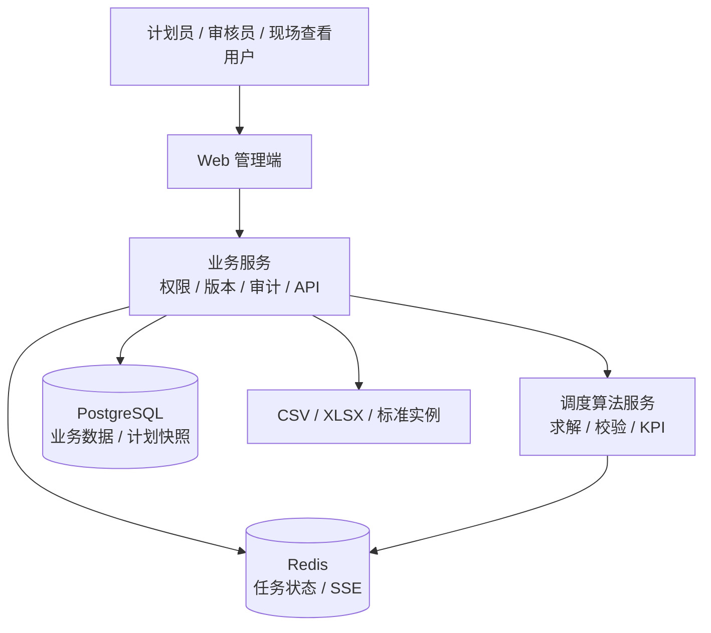

# 动态柔性车间生产调度与仿真决策系统

## 文档信息

| 项目 | 内容 |
|---|---|
| 文档类型 | 研发内部标准 PRD |
| 产品名称 | 动态柔性车间生产调度与仿真决策系统 |
| 产品版本 | V1.1 |
| 作者 | 熊英孜 |
| 审核者 | 待指 |
| 编写日期 | 2026-09-16 |
| 适用端 | Web 管理端、调度算法服务 |
| 适用角色 | 系统管理员、生产计划员、调度审核员、现场查看用户 |
| 适用范围 | 可运行原型、算法实验和演示环境 |
| 变更说明 | 按研发内部标准 PRD 模板重组；研发算法、接口、数据模型和实验内容见[研发附录](动态柔性车间生产调度与仿真决策系统研发附录.md) |

## 1 引言

### 1.1 编写目的

本文档用于明确动态柔性车间生产调度与仿真决策系统 V1.1 的业务目标、功能范围、页面规则、数据规则、角色权限、异常流程、非功能要求和验收标准，作为产品评审、研发设计、测试用例编写和演示验收依据。

本文档只描述产品侧需求。调度模型、目标函数、算法编码、接口字段契约、数据库对象、实验方案和实现约束统一放在[研发附录](动态柔性车间生产调度与仿真决策系统研发附录.md)，两份文档必须使用相同的订单、工序、设备、事件、版本和 KPI 口径。

### 1.2 背景

当前柔性车间中，一张订单包含多个有先后关系的工序，每道工序可从候选设备中选择一台加工。人工排产或静态排程在订单插单、设备故障发生后需要反复调整机器选择和工序顺序，容易出现资源冲突、工艺顺序错误和交期失控。

同时，原计划、重排计划与现场实际执行分散保存，计划员难以解释哪些工序受影响、为什么延期、变更造成了多大扰动，算法实验也难以与系统运行保持同一套数据和 KPI 口径。

本期建设单车间 Web 原型，形成“基础数据维护 → 基线排程 → 事件录入 → 局部/完全重调度 → 方案对比 → 审核发布 → 实际反馈”的闭环，重点验证动态调度决策和可解释展示能力，不替代完整 MES/ERP，不控制真实设备。

### 1.3 术语与缩写解释

| 术语/缩写 | 定义 |
|---|---|
| FJSP | Flexible Job Shop Scheduling Problem，柔性车间调度问题 |
| 订单/工件 | 待加工的产品或订单，记为 `J_i` |
| 工序 | 订单中的一道加工步骤，记为 `O_ij`，工序间有先后关系 |
| 设备/机器 | 可执行工序的资源，记为 `M_k` |
| 候选设备 | 某道工序允许使用的设备集合 |
| 基线计划 | 一批订单首次排程生成的计划版本 |
| 局部重调度 | 只调整事件影响集合内未开始工序的重调度 |
| 完全重调度 | 调整事件发生后所有未完成且未冻结工序的重调度 |
| 冻结窗口 | 从事件发生时间起，计划不允许变化的时间区间；V1 默认 30 分钟 |
| 影响集合 | 受事件直接、后继、资源冲突或日历冲突影响的工序集合 |
| 仿真时钟 | 任务和事件使用的业务时间，不依赖服务器当前时间 |
| `C_max` | 所有订单最终完成时间的最大值 |
| `T_i` | 订单拖期，`max(0, C_i - dueTime_i)` |
| `Delta_plan` | 综合开始时间、设备和同机顺序变化的计划调整幅度 |
| KPI | Key Performance Indicator，关键绩效指标 |
| 计划版本 | 一次排程结果的不可变快照，编号示例为 `PV-002`；支持审核、发布、执行和回溯，不等同于产品版本、工艺模板版本或算法版本 |

### 1.4 参考资料

| 资料 | 用途 |
|---|---|
| [资料收集整理.md](资料收集整理.md) | FJSP 建模、动态事件、遗传算法、甘特图、技术架构和 MVP 范围依据 |
| Brandimarte, 1993 | FJSP 标准算例和机器路由/排序建模参考 |
| Kacem et al., 2002 | 多目标 FJSP 与机器负荷指标参考 |
| Li & Gao, 2016 | 混合遗传算法与局部搜索参考 |
| Chen, Ji & Wang, 2018 | 设备故障动态 FJSP 参考 |
| [研发附录](动态柔性车间生产调度与仿真决策系统研发附录.md) | 算法、接口、数据模型和实验实施细则 |

## 2 需求概述

### 2.1 V1 范围与成功标准

#### 本期支持

1. 单车间，最多 50 个订单、12 台设备；页面演示规模为 20 个订单、8 台设备。
2. 订单插单和设备故障两类动态事件，一次重调度任务关联一个事件。
3. 基线排程、局部重调度和完全重调度，局部模式为默认模式。
4. 工序不可拆分、不可抢占；每道工序从候选设备中选择一台。
5. 固定加工时间、准备时间、换型时间、设备工作日历和维修不可用区间。
6. CSV/XLSX 导入、CSV 导出、资源甘特、订单甘特、方案对比、审核发布、回滚和实际反馈。

#### 本期不支持

订单取消、随机加工时间、批量拆分/合批、并行加工、物料短缺、人员约束、多车间协同、预测性维修、主动抢占、故障中途转移或返工、真实设备控制、MES/ERP 实时接入、复杂成本核算、实时协同编辑、PDF/图片导出。

#### 成功标准

| 指标 | 目标 |
|---|---:|
| 创建排程任务接口 | P95 ≤ 2 秒返回 `taskId` |
| 演示规模求解 | 20 个订单、8 台设备时 ≤ 60 秒返回可行解或明确无解 |
| 约束通过率 | 进入审核的计划 100% 通过后端全量校验 |
| 影响集合准确率 | 测试标注场景 100% 一致 |
| 冻结工序锁定正确率 | 已完成、在制、冻结工序 100% 不被修改 |
| 关键查询 | P95 ≤ 3 秒 |
| 版本追溯率 | 计划、输入快照、参数、审核、发布记录 100% 可追溯 |

### 2.2 总体功能架构（图）



业务服务负责权限、基础数据、事件、版本、审核、发布、审计和页面查询；算法服务只读取输入快照并返回候选结果，不直接修改业务库。研发实现边界见研发附录第 2、3 章。

### 2.3 技术框架

#### 2.3.1 技术栈

| 层级 | V1 技术选型 | 主要职责 |
|---|---|---|
| 前端 | Vue 3、TypeScript、Vite、ECharts | 页面交互、权限展示、甘特图、SSE/轮询、表单校验 |
| 业务服务 | Java 17、Spring Boot | 认证鉴权、基础数据、事件、计划版本、审核发布、审计和 API |
| 算法服务 | Python 3.11+、FastAPI | FJSP 编码、求解、可行性校验、KPI 计算、任务进度 |
| 关系数据库 | PostgreSQL 14+ | 业务数据、计划版本、输入快照、执行记录和审计日志 |
| 任务与消息 | Redis | 异步任务状态、SSE 进度、短期缓存和幂等记录 |
| 文件处理 | 业务服务文件模块 | CSV/XLSX 模板、导入预览、批次结果和 CSV 导出 |
| 部署 | Docker Compose（V1 演示） | 前端、业务服务、算法服务、PostgreSQL、Redis 统一启动 |

#### 2.3.2 服务边界

1. 前端不直接访问数据库或算法服务；所有业务请求经过业务服务鉴权和审计。
2. 业务服务是订单、设备、事件、计划版本和执行反馈的唯一写入入口。
3. 算法服务只读取业务服务生成的输入快照，返回候选结果和运行元数据，不直接修改业务库。
4. 业务服务负责算法结果的最终约束校验、KPI 复核、计划版本生成和状态转换。
5. Redis 中的任务状态丢失时，以数据库中的任务状态和结果为准；SSE 不是计划数据的唯一来源。

#### 2.3.3 核心数据流

```text
Web 前端 → 业务服务 → PostgreSQL
                    → Redis（任务状态/进度）
                    → 算法服务 → Redis（进度）
                    ← 算法结果 ← 算法服务
CSV/XLSX → 业务服务预览校验 → 整批入库
```

#### 2.3.4 V1 技术约束

- 所有服务使用 UTF-8；接口时间使用 ISO 8601，数据库统一 UTC。
- 任务创建接口只负责入队，不同步等待算法求解；单任务时间上限 1—600 秒。
- 计划版本和输入快照不可变；主数据修改不得回写历史计划。
- 业务服务和算法服务通过版本化 JSON 契约通信，契约变更必须同步更新研发附录和测试样例。
- V1 不接入真实设备、MES/ERP、对象存储、消息队列集群和多租户平台；相关能力列为后续架构扩展。

#### 2.3.5 可观测性与故障隔离

所有请求携带 `requestId`；业务服务、算法服务和异步任务日志使用同一请求 ID 和 `taskId` 关联。算法服务超时、崩溃或不可用时，已发布计划查询、版本查询和实际反馈不受影响；任务标记为 `TIME_LIMIT` 或失败并保存错误摘要。

技术选型的详细依赖版本、接口契约、数据表和部署参数见[研发附录](动态柔性车间生产调度与仿真决策系统研发附录.md)第 1—4 章。

### 2.4 菜单设置

| 一级菜单 | 二级菜单 | 页面/功能 | 所属端 | 权限编码 |
|---|---|---|---|---|
| 工作台 | 调度看板 | 当前发布计划、KPI、事件和任务 | Web | `dashboard:view` |
| 基础数据 | 设备管理 | 设备能力、状态、停用、负荷 | Web | `machine:manage` |
| 基础数据 | 设备日历 | 班次、节假日、维修区间 | Web | `calendar:manage` |
| 基础数据 | 工艺模板 | 工艺版本、工序、候选设备 | Web | `process-template:manage` |
| 基础数据 | 订单管理 | 订单和工序 | Web | `order:manage` |
| 基础数据 | 批量导入 | 模板、预览、校验、批次结果 | Web | `data-import:manage` |
| 计划调度 | 基线排程 | 创建基线任务 | Web | `schedule:create` |
| 计划调度 | 调度任务 | 进度、日志、结果、重试 | Web | `task:view` |
| 计划调度 | 计划版本 | 版本详情、差异、回滚 | Web | `plan-version:view` |
| 事件管理 | 订单插单 | 创建和查询插单事件 | Web | `event:insert-order` |
| 事件管理 | 设备故障 | 创建和查询故障事件 | Web | `event:breakdown` |
| 结果分析 | 资源甘特 | 设备维度计划分析 | Web | `gantt:resource:view` |
| 结果分析 | 订单甘特 | 订单维度计划分析 | Web | `gantt:order:view` |
| 结果分析 | 方案对比 | 新旧计划和实际对比 | Web | `plan:compare` |
| 审核发布 | 待审核方案 | 审核、驳回、发布 | Web | `plan:review` |
| 执行反馈 | 实际执行 | 开始、暂停、完成、异常反馈 | Web | `execution:feedback` |
| 系统管理 | 用户与角色 | 用户、角色、数据范围 | Web | `user-role:manage` |
| 系统管理 | 字典与审计 | 配置和操作审计 | Web | `dictionary:audit:manage` |

### 2.5 功能清单

| 编号 | 功能名称 | 所属端 | 主要角色 | 版本 | 关联章节 |
|---|---|---|---|---|---|
| F-01 | 工作台与调度看板 | Web | 全部 | MVP | 3.1 |
| F-02 | 设备与设备日历管理 | Web | 管理员、计划员 | MVP | 3.2 |
| F-03 | 工艺模板管理 | Web | 管理员、计划员 | MVP | 3.3 |
| F-04 | 订单与工序管理 | Web | 计划员 | MVP | 3.4 |
| F-05 | 批量导入与校验 | Web | 管理员、计划员 | MVP | 3.5 |
| F-06 | 基线排程与任务管理 | Web + 算法服务 | 计划员 | MVP | 3.6 |
| F-07 | 插单与设备故障事件 | Web | 计划员、管理员 | MVP | 3.7 |
| F-08 | 局部/完全重调度 | Web + 算法服务 | 计划员 | MVP | 3.8 |
| F-09 | 甘特图与方案对比 | Web | 全部 | MVP | 3.9 |
| F-10 | 审核、发布与回滚 | Web | 计划员、审核员 | MVP | 3.10 |
| F-11 | 实际执行反馈 | Web | 现场用户、管理员 | MVP | 3.11 |
| F-12 | 用户、字典与审计 | Web | 管理员、审核员 | MVP | 3.12 |

## 3 功能需求

### 3.1 工作台与调度看板

#### 3.1.1 功能描述

为计划员、审核员和现场查看用户提供当前生产状态统一入口。系统根据用户数据权限加载当前发布计划（及其计划版本号，如 `PV-002`）、订单执行状态、设备状态、待审核方案、最近事件和算法任务，并支持从 KPI 直接跳转到结果页。

#### 3.1.2 业务流程

```text
用户登录 → 校验菜单和数据权限 → 加载当前发布计划
→ 查询 KPI、事件、任务和异常 → 用户筛选或点击卡片
→ 跳转甘特/详情 → 查看数据和可用操作
```

异常流程：无当前发布计划时显示创建基线入口；接口超时保留最近一次成功数据并提示重试；无数据权限的订单不进入列表和 KPI 分母；无异常时显示空状态。

#### 3.1.3 详细需求

| 页面元素 | 规则 |
|---|---|
| 计划下拉框 | 默认当前发布计划；选项同时显示计划名称、计划版本号（如 `PV-002`）、状态和发布时间，仅展示有权限的计划版本 |
| 时间窗口 | 默认当前班次，可选最近 24 小时或自定义范围 |
| KPI 卡片 | 展示 `C_max`、加权拖期、延期订单数、设备利用率、待审核数、故障设备数；点击带条件跳转 |
| 最近事件 | 倒序展示最近 20 条事件，显示类型、时间、状态、关联对象和影响工序数 |
| 算法任务 | 展示最近 10 条任务及进度、耗时、结果版本和操作按钮 |
| 异常列表 | 延期、不可行、数据错误和执行偏差按严重级别排序 |

验收：首屏 P95 ≤ 3 秒；筛选条件在刷新后保留；看板 KPI 与版本详情 KPI 一致。

### 3.2 设备与设备日历管理

#### 3.2.1 功能描述

支持设备能力、工作中心、启停状态和工作日历维护，为工艺模板、排程和甘特提供唯一设备数据来源。已被历史计划引用的设备不能物理删除，日历变更不得改写历史计划快照。

#### 3.2.2 业务流程

```text
进入设备管理 → 查询/新增/编辑设备 → 校验编号、能力和日历
→ 保存并记录变更 → 查看设备详情/负荷
进入设备日历 → 配置班次、节假日或维修区间 → 校验区间
→ 生成日历版本 → 后续新任务使用新版本
```

异常流程：编号重复、工作中心不存在、日历未启用、时间区间重叠时禁止保存；设备被引用时禁止删除；接口失败保留表单内容且原数据不变。

#### 3.2.3 详细需求

设备字段：`machineId`、名称、`workCenterId`、产品族能力、`calendarId`、状态、备注。状态为 `IDLE/RUNNING/BREAKDOWN/MAINTENANCE/DISABLED`。

日历字段：日期、班次开始/结束、类型（班次/节假日/维修）、备注。区间不得交叉，结束时间必须晚于开始时间，维修区间不得覆盖已完成历史执行记录。停用设备不可被新工艺或排程任务选用。

验收：设备停用后新任务候选设备列表不再出现该设备；历史版本仍能展示原设备和原日历；日历冲突错误能定位到具体区间。

### 3.3 工艺模板管理

#### 3.3.1 功能描述

维护产品族的工艺模板和版本，定义有序工序、候选设备、加工时间、准备时间和产品族。模板是订单生成工序和算法排程的来源。

#### 3.3.2 业务流程

```text
进入工艺模板 → 查询模板/版本 → 新增或复制版本
→ 编辑工序及候选设备 → 校验序号、设备能力和时长
→ 保存为草稿/启用版本 → 新订单选择启用版本
```

异常流程：工序序号不连续、候选设备为空或无能力、加工/准备时间不大于 0 时禁止启用；已被订单引用的版本不能覆盖编辑，只能复制新版本。候选设备加工/准备时长缺失且无可用模板默认值时，导入预览必须报错；仅在模板实例化阶段允许使用模板默认值并固化，运行时不得隐式回退。

#### 3.3.3 详细需求

模板字段：模板编号、产品族、版本号、状态、备注。工序字段：序号、名称、候选设备-时长对、`processTimeMinutes(machine)`、`setupTimeMinutes(machine)`、产品族。每个候选设备必须配置独立且大于 0 的加工/准备时长；缺失值只可在模板实例化时使用模板默认值，并固化到订单工序和任务输入快照，运行时不得隐式回退。支持复制、启用、停用和查看引用订单。

验收：模板至少有一道工序；每道工序至少一个候选设备；候选设备时长完整且可追溯到订单工序和输入快照；旧版本和引用订单不受新版本修改影响。

### 3.4 订单与工序管理

#### 3.4.1 功能描述

支持订单录入、查询、编辑和状态查看。订单选择启用的工艺模板后生成工序，供基线排程或插单事件使用。

#### 3.4.2 业务流程

```text
进入订单管理 → 新增订单 → 选择产品族和模板版本
→ 填写数量、到达时间、交货期和优先级 → 字段校验
→ 保存订单并生成工序 → 查询工序详情/锁定状态
```

订单进入 `SCHEDULED` 后，影响当前计划的工艺字段不可直接编辑；需要变更时生成修订记录并重新排程。

#### 3.4.3 详细需求

订单字段：编号、产品族、数量、到达时间、交货期、优先级（1—5）、模板版本、备注。数量为正整数；`dueTime >= arrivalTime`；首道工序不得早于到达时间。V1 订单不可拆分，`processTimeMinutes(machine)` 为全部数量在指定设备上的固定总加工时长，不按数量再次相乘；数量只用于执行反馈的完成/合格数量校验。

工序列表展示序号、名称、候选设备、加工/准备时长、计划状态、实际状态、冻结标记和关联事件。已完成工序只读。

### 3.5 批量导入与校验

#### 3.5.1 功能描述

支持设备、日历、工艺模板、订单和工序按模板批量导入。导入先预览、再校验、后整批入库，避免错误数据进入排程。

#### 3.5.2 业务流程

```text
下载模板 → 上传 CSV/XLSX → 字段映射 → 预览校验
→ 查看错误行 → 修正并重新上传 → 确认入库 → 查看批次结果
```

异常流程：格式、大小或字段不符合要求时拒绝预览；存在错误行时默认不入库；相同文件摘要和幂等键重复提交时返回原批次结果；接口失败不产生半批数据。

#### 3.5.3 详细需求

预览结果必须返回批次号、文件摘要、总行数、成功行数、错误行数、逐行错误码、字段名、原值和修正建议。错误包括编号重复、引用不存在、时间倒置、候选设备为空、时长非法和区间重叠。

验收：非法数据 100% 被拦截；确认前数据库无写入；成功入库后生成导入批次和操作审计。

### 3.6 基线排程与任务管理

#### 3.6.1 功能描述

计划员选择待排程订单和仿真起点，配置基线目标权重及算法参数，创建异步排程任务。系统保存输入快照，算法完成后由业务服务校验并生成 `DRAFT` 计划版本。

#### 3.6.2 业务流程

```text
选择 WAITING 订单 → 填写仿真起点和参数 → 预校验订单规模与工艺
→ 创建任务并返回 taskId → 查看 SSE 进度/轮询状态
→ 获取候选结果 → 后端全量约束校验 → 生成 DRAFT 或返回不可行
```

任务状态：`PENDING`、`RUNNING`、`SUCCESS`、`INFEASIBLE`、`TIME_LIMIT`、`CANCELLED`。任务结果另返回 `resultStatus` 和 `feasibleSolution`；仅 `SUCCESS` 或 `TIME_LIMIT + feasibleSolution=true` 允许生成草稿版本。

#### 3.6.3 详细需求

页面参数：订单批次、`simulationStartAt`、冻结窗口、目标权重、种群规模、最大代数、随机种子和时间上限。动态重调度的 `Delta_plan` 默认权重为 `0.5/0.3/0.2`，允许按车间配置；配置版本和实际权重必须随任务输入快照保存。提交前显示订单数、工序数、候选设备覆盖率和预计规模；缺失工艺、无候选设备或时间关系错误时禁止提交。

任务详情包含概览、实时进度、参数、日志、结果和错误六个区域。支持取消、重试、查看甘特、查看冲突和提交审核。重复提交使用输入快照、参数和随机种子生成的幂等指纹；多个局部/完全候选方案共享 `candidateGroupId`，只有选中的候选版本可以提交审核。

验收：接口 P95 ≤ 2 秒返回 `taskId`；演示规模 ≤ 60 秒返回可行解或明确无解；任务刷新或断线重连不创建重复任务。

### 3.7 插单与设备故障事件

#### 3.7.1 功能描述

支持订单插单和设备故障两类事件。事件记录发生时间、录入时间、来源、关联对象、影响集合、关联任务和修订链，为重调度提供输入并保留事件前计划。

#### 3.7.2 业务流程

```text
进入事件管理 → 选择事件类型 → 填写字段 → 校验时间和对象
→ 保存 Event → 计算影响集合 → 关联当前发布计划
→ 创建重调度任务或关闭事件
```

#### 3.7.3 详细需求

订单插单字段：事件子类型（`URGENT_INSERT` 紧急插单 / `NORMAL_APPEND` 常规追加）、订单编号、产品族、数量、模板版本、到达时间、交货期、优先级、发生时间、备注。系统在同一事务中创建订单和事件；成功后提供局部重调度入口。

设备故障字段：设备、发生时间、维修时长、来源、说明。故障不得落在已开始但未完成的加工区间内；维修区间 `[breakdownTime, repairEndTime)` 不可排程。V1 不支持暂停续作、转移剩余工时或报废重做。

事件一经用于求解不可静默编辑；更正必须生成新事件并保存 `revisionOf` 和修订原因。事件关闭前不得存在待处理任务，关闭后不可删除。

### 3.8 局部/完全重调度

#### 3.8.1 功能描述

基于原计划和事件生成候选重调度方案。局部模式只调整影响集合内未开始工序；完全模式调整事件发生后所有未完成且不在冻结窗口内的工序。已完成、在制和冻结工序为硬锁定。

#### 3.8.2 业务流程

```text
从事件或版本详情进入向导 → 选择原计划和模式 → 查看影响集合与锁定数量
→ 配置冻结窗口和目标权重 → 创建任务 → 求解和校验
→ 查看局部/完全方案 → 选择候选版本进入审核
```

异常流程：原计划已过期、事件已关闭、候选设备不足或维修占满时间时禁止提交或返回可解释不可行结果；软锁定工序若被迫调整必须展示原因码。

#### 3.8.3 详细需求

向导必须展示硬锁定数量、软锁定数量、影响工序数、受影响订单、原计划版本和预计求解规模。结果展示设备、准备/加工/占用开始时间、结束时间、换型时长、冻结标记、影响类型、变更原因、约束结果和 KPI；局部与完全方案可并列比较，并显示候选组、候选类型和当前选中状态。

### 3.9 甘特图与方案对比

#### 3.9.1 功能描述

提供资源甘特、订单甘特和方案对比，帮助用户查看设备负荷、订单工序链、故障维修、换型区间、交期和实际偏差。V1 只读，不支持拖拽直接改排程。

#### 3.9.2 业务流程

```text
进入资源甘特/订单甘特 → 选择版本和时间窗口 → 筛选设备/订单/异常
→ 缩放或定位时间 → 点击任务查看侧栏 → 切换方案对比
→ 查看差异并导出当前筛选结果
```

#### 3.9.3 详细需求

资源甘特按工作中心/设备展示计划条、准备/换型条、实际条、故障维修区间、非工作区间、仿真当前时间线和交期线。订单甘特展示订单、工序序号、设备、完成率、交期、拖期和关键路径。

详情侧栏至少显示订单、工序、设备、计划/实际时间、前后置工序、冻结状态、影响类型、事件编号、变更原因、KPI 贡献和审计记录。方案对比支持“全部/仅变化/仅延期/仅冲突”筛选，展示时间偏差、设备变化、同机顺序变化、延期变化和 `Delta_plan`。

颜色不能作为唯一语义，必须同时使用状态文字、图标或纹理；任务点击应在资源视图和订单视图之间联动定位。

### 3.10 审核、发布与回滚

#### 3.10.1 功能描述

候选版本必须经过计划员提交、审核员审核和审核员发布。计划版本不可变；回滚通过历史版本复制生成新草稿，不覆盖历史计划和实际执行记录。

#### 3.10.2 业务流程

```text
DRAFT → 提交审核 → REVIEW_PENDING → 审核通过/驳回
→ REVIEWED → 发布 → PUBLISHED → EXECUTING → CLOSED
驳回 → REJECTED → 原计划员修订 → DRAFT
历史已发布计划版本在新计划版本发布后 → SUPERSEDED
```

#### 3.10.3 详细需求

提交审核前再次执行全量校验，并检查候选版本基于当前发布计划、事件和输入快照。驳回必须填写原因，创建人和审核人不能为同一用户。

发布事务必须校验状态、数据权限、乐观锁、约束结果和当前车间执行版本；失败时整体回滚。当前发布版本下任一工序首次成功写入 `status=RUNNING` 且 `actualStartAt` 通过校验后，计划版本才从 `PUBLISHED` 转为 `EXECUTING`，该转换与执行反馈在同一事务内完成；仅计划时间到达、暂停或异常登记不触发。回滚先复制计划、日历和工艺快照生成带父版本的新 `DRAFT`，不复制实际执行记录；若历史快照与当前已完成、加工中或冻结工序冲突，返回 `E_ROLLBACK_CONFLICT`，不生成可发布草稿；无冲突时叠加当前硬锁定工序。所有状态变化记录操作人、时间、请求 ID、前后状态和备注。

### 3.11 实际执行反馈

#### 3.11.1 功能描述

现场用户在当前发布计划上反馈工序实际开始、暂停、恢复、完成和异常，系统独立保存实际时间线，不修改计划时间。管理员可对已完成记录发起带审批的异常更正。

#### 3.11.2 业务流程

```text
进入实际执行 → 按版本/设备/订单筛选 → 选择工序
→ 开始/暂停/恢复/完成/异常 → 校验时间、数量和权限
→ 保存 ExecutionRecord → 更新甘特实际条和偏差标记
```

#### 3.11.3 详细需求

开始填写实际开始时间；暂停填写原因；恢复生成恢复时间；完成填写结束时间、完成数量和合格数量；异常选择原因码并填写备注。实际完成前必须有实际开始，合格数量不得大于完成数量，数量不得超过订单数量。

计划与实际开始/结束偏差超过 15 分钟时生成 `EXECUTION_DEVIATION` 标记和重调度入口。V1 不自动触发算法任务；重复提交使用版本号检测并发冲突。

### 3.12 用户、字典与审计

#### 3.12.1 功能描述

管理员维护用户、角色、数据范围、优先级权重、事件类型、原因码、冻结窗口默认值和执行偏差阈值；系统记录所有关键操作，保证权限隔离和历史追溯。

#### 3.12.2 业务流程

```text
管理员进入系统管理 → 新增/停用用户或配置字典
→ 校验唯一性和引用关系 → 保存配置版本
→ 用户登录时加载有效权限 → 写操作同步生成审计记录
```

#### 3.12.3 详细需求

权限分为菜单、按钮、接口和数据范围四层；计划员不能审核或发布自己提交的方案；停用用户不能登录或创建任务，但历史数据保留。配置变更生成版本和生效时间，已创建任务使用输入快照中的旧配置。

审计列表支持按用户、模块、操作类型、时间、请求 ID 和业务对象筛选，查看变更前后摘要；审计记录不可编辑和删除，导出审计数据也必须记录日志。

## 4 字典

### 4.1 订单状态

| 代码 | 名称 | 说明 |
|---|---|---|
| `WAITING` | 待排程 | 已到达但未生成计划 |
| `SCHEDULED` | 已排程 | 存在候选或发布计划 |
| `RUNNING` | 进行中 | 至少一道工序执行中 |
| `COMPLETED` | 已完成 | 全部工序完成 |
| `DELAYED` | 延期 | 完成时间超过交货期 |
| `EXCEPTION` | 异常 | 存在故障、质量或数据异常 |

### 4.2 工序状态与标记

| 代码 | 名称 | 说明 |
|---|---|---|
| `NOT_STARTED` | 未开始 | 尚未加工 |
| `WAITING` | 等待 | 等待前工序、日历或资源 |
| `RUNNING` | 加工中 | 设备正在执行 |
| `COMPLETED` | 已完成 | 已反馈实际完成 |
| `FROZEN` | 冻结标记 | 不允许被重调度移动 |
| `DELAYED` | 延期标记 | 计划或实际完成超过交期 |
| `EXCEPTION` | 异常标记 | 存在未处理异常 |

### 4.3 设备状态

`IDLE` 空闲、`RUNNING` 加工中、`BREAKDOWN` 故障、`MAINTENANCE` 维修中、`DISABLED` 停用。

### 4.4 事件类型与状态

事件类型：`NEW_ORDER` 订单插单、`BREAKDOWN` 设备故障。

事件状态：`CREATED` 已录入、`CONFIRMED` 已确认、`USED_FOR_SOLVE` 已用于求解、`CLOSED` 已关闭。

### 4.5 计划版本状态

`DRAFT` 草稿、`REVIEW_PENDING` 待审核、`REVIEWED` 已审核、`REJECTED` 已驳回、`PUBLISHED` 已发布、`EXECUTING` 执行中、`CLOSED` 已关闭、`SUPERSEDED` 已被新版本替代。

状态转换约束：`DRAFT` 只能提交审核或删除草稿；`REVIEW_PENDING` 只能由审核员通过或驳回；`REVIEWED` 只能发布；当前发布版本下任一工序首次成功写入 `status=RUNNING` 且 `actualStartAt` 通过校验后，`PUBLISHED` 才能转为 `EXECUTING`，仅计划时间到达、暂停或异常登记不触发；`EXECUTING` 在订单全部完成或计划关闭时转为 `CLOSED`。`REJECTED`、`CLOSED` 和 `SUPERSEDED` 只读，修订必须生成新草稿。

### 4.6 任务运行状态

`PENDING` 待运行、`RUNNING` 运行中、`SUCCESS` 成功、`INFEASIBLE` 不可行、`TIME_LIMIT` 超时、`CANCELLED` 已取消。任务同时返回 `resultStatus` 和 `feasibleSolution`；V1 不新增 `PARTIAL_SUCCESS` 状态，带可行解的超时通过结果字段表达。

### 4.7 优先级与原因码

优先级 1—5 映射为权重 1、2、3、5、8。原因码至少包括 `PREDECESSOR_WAIT` 前工序等待、`CALENDAR_BLOCKED` 日历阻塞、`MACHINE_BREAKDOWN` 设备故障、`MACHINE_CHANGED` 设备变更、`SEQUENCE_CHANGED` 顺序变更、`EXECUTION_DEVIATION` 执行偏差。

## 5 非功能需求

### 5.1 系统性能需求

#### 5.1.1 响应时间

| 功能 | 目标 | 测试口径 |
|---|---:|---|
| 列表/详情查询 | P95 ≤ 3 秒 | 分页、权限过滤和基础筛选 |
| 新增/修改/状态操作 | P95 ≤ 3 秒 | 不含异步算法求解 |
| 导入预览 | 30 秒内 | 10,000 行文件 |
| 甘特首屏 | 3 秒内 | 20 单、8 设备、24 小时时间窗口 |
| 创建算法任务 | P95 ≤ 2 秒 | 只返回 `taskId` |
| 演示规模求解 | ≤ 60 秒 | 20 单、8 设备、固定随机种子 |

#### 5.1.2 用户并发数

V1 演示目标支持 50 个在线用户、20 个活跃并发用户；查询接口 P95 ≤ 3 秒，新增/修改接口 P95 ≤ 3 秒，算法任务异步执行。500 在线用户、100 活跃并发用户属于后续生产化目标，不作为 V1 验收条件。

#### 5.1.3 资源消耗

在 4C8G 应用服务器和 4C16G 数据库服务器的测试环境中，应用 CPU 平均利用率不超过 60%，内存使用率不超过 80%，接口错误率低于 0.1%。算法进程需设置单任务时间上限和资源配额。

### 5.2 安全性需求

1. 所有接口校验登录态、菜单权限、按钮权限和数据权限，后端不得仅依赖前端隐藏按钮。
2. 计划员、审核员和现场查看用户职责分离；计划员不能审核或发布自己提交的方案。
3. 订单、设备、事件、任务、计划版本、导入、导出、审核、发布和回滚均写入审计日志。
4. 导入限制 CSV/XLSX 格式和文件大小，校验公式、脚本和路径；导出按数据权限过滤。
5. SSE 连接校验登录态和任务权限，断线重连不得重复创建任务。
6. 安全扫描不得存在高/中风险漏洞；重点覆盖越权、重复提交、SQL 注入和文件上传安全。审计和任务快照中的令牌、密码、完整文件路径及不必要的个人信息必须脱敏。

### 5.3 兼容性需求

| 类型 | V1 目标 |
|---|---|
| 浏览器 | Chrome 120+、Edge 120+ |
| 操作系统 | Windows 10/11；国产化适配后续确认 |
| 数据库 | PostgreSQL 14+ |
| 服务端 | Java 17、Python 3.11+ |
| 文件格式 | CSV、XLSX；CSV 导出 UTF-8 with BOM |
| 时间格式 | ISO 8601，数据库 UTC，前端按用户时区展示 |

### 5.4 可追溯、可恢复与可维护性

- 每个计划版本保存订单、工艺、设备能力、日历、事件、算法版本、参数和随机种子快照。
- 已发布计划版本只读；回滚以新计划版本实现，不删除历史计划版本和实际执行数据。
- 算法服务异常、超时或进程崩溃不得影响已发布计划查询。
- 业务计划、事件、任务输入快照和审计日志默认保留 365 天；运行日志保留 90 天；数据库备份保留 30 天，部署环境可按需延长。
- 删除或归档操作本身必须写入审计；数据库每日备份，备份恢复必须至少演练一次。

## 6 填写检查清单

1. 范围是否清楚：是否说明本期做什么、不做什么、涉及哪些端和角色。
2. 流程是否闭环：是否包含主流程、异常流程、状态流转和操作结果。
3. 页面是否清楚：是否有入口、页面区域、按钮、列表、弹窗、空状态、加载状态和错误提示。
4. 字段是否完整：是否包含字段名称、控件类型、必填、可编辑、默认值、数据来源、校验规则和错误提示。
5. 权限是否明确：是否覆盖菜单、按钮、接口和数据范围。
6. 接口数据是否明确：接口入参、出参、错误码、幂等和数据落库规则是否见研发附录。
7. 异常边界是否覆盖：无权限、空数据、重复提交、接口失败、并发编辑、关联数据删除、导入错误和算法不可行是否有说明。
8. 验收标准是否可测试：是否包含前置条件、操作步骤、预期结果和量化指标。
9. 上线是否可控：是否说明初始化数据、配置、备份、迁移和回滚步骤。

## 7 MVP 验收用例

| 用例 | 前置条件 | 操作 | 预期结果 |
|---|---|---|---|
| 工作台空状态 | 无当前发布计划 | 登录工作台 | P95 ≤ 3 秒显示空状态和创建基线入口 |
| 设备停用 | 设备被历史计划引用 | 停用设备 | 禁止物理删除；新任务不可选用；历史版本可查询 |
| 模板版本 | 模板已被订单引用 | 复制并启用新版本 | 原版本只读；已有订单继续引用原版本 |
| 批量导入 | 文件含重复订单和空候选 | 上传并确认 | 错误行全部拦截；错误批次不写入数据库 |
| 基线排程 | 20 单、8 设备、数据合法 | 创建任务并等待完成 | ≤60 秒返回可行解；生成 `DRAFT` |
| 插单重调度 | 存在已发布计划 | 插入订单并局部求解 | 原计划版本不变；生成事件和候选版本；影响集合准确率 100% |
| 加工中故障 | 故障时间落在加工区间 | 提交故障 | 拒绝并返回 `E_EVENT_IN_PROCESS` |
| 冻结校验 | 存在完成、在制和冻结工序 | 创建重调度 | 三类工序机器、开始和执行状态 100% 不变 |
| 审核驳回 | 存在待审核版本 | 不填写原因直接驳回 | 操作被拒绝；填写原因后变为 `REJECTED` |
| 并发发布 | 两个候选同时发布 | 先后点击发布 | 仅一个成功；另一个返回 `E_VERSION_STALE` |
| 发布后首次执行 | 当前版本已发布 | 首次提交工序开始反馈 | 校验 `RUNNING + actualStartAt` 后同事务将版本转为 `EXECUTING`；仅计划时间到达、暂停或异常登记不触发 |
| 回滚冲突 | 历史快照与当前硬锁定工序冲突 | 提交回滚 | 返回 `E_ROLLBACK_CONFLICT`，不生成可发布草稿，历史计划和实际记录不变 |
| 实际反馈 | 存在执行中工序 | 开始、暂停、恢复、完成 | 状态顺序和数量校验通过；计划条不变 |
| 权限隔离 | 计划员提交方案 | 使用同账号审核 | 按钮不可见或接口返回 `E_AUTH_FORBIDDEN` |
| 审计追溯 | 已执行导入、事件、审核和发布 | 查询审计 | 每项含操作人、时间、请求 ID、前后状态和对象 |
