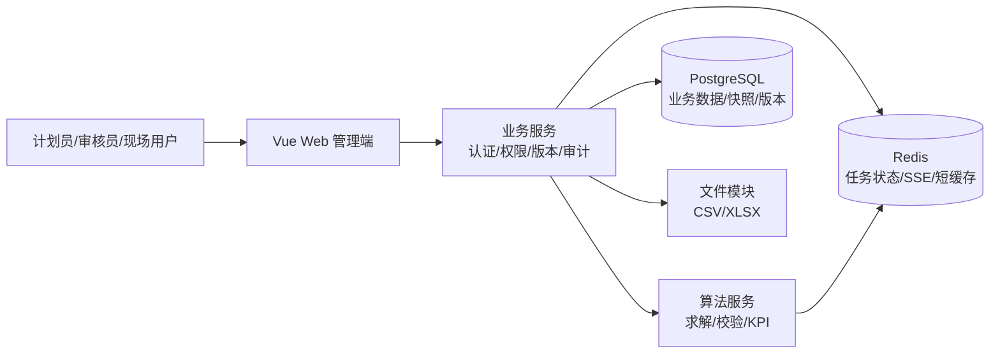
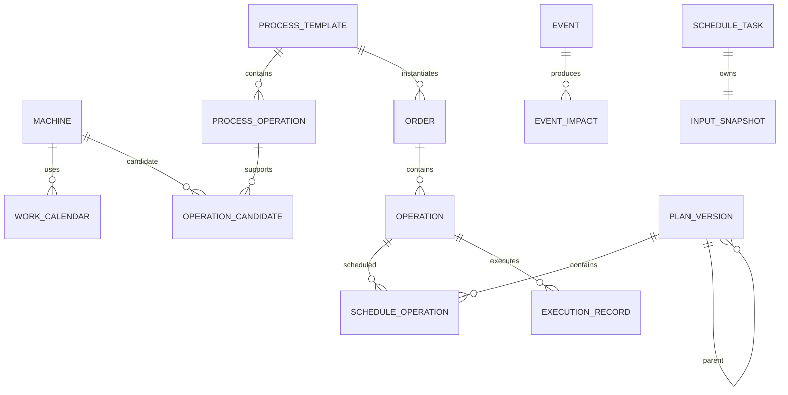

# 动态柔性车间生产调度与仿真决策系统

## 系统设计说明书

| 项目 | 内容 |
|---|---|
| 文档类型 | V1.1 系统设计说明书 |
| 对应 PRD | [动态柔性车间生产调度与仿真决策系统PRD](动态柔性车间生产调度与仿真决策系统PRD.md) |
| 对应研发附录 | [动态柔性车间生产调度与仿真决策系统研发附录](动态柔性车间生产调度与仿真决策系统研发附录.md) |
| 适用范围 | 单车间 Web 管理端、业务服务、调度算法服务和演示部署 |
| 版本 | V1.1 |
| 编写日期 | 2026-09-20 |
| 状态 | 设计基线（已定稿） |

## 1 设计目标与边界

### 1.1 设计目标

系统形成以下闭环：

```text
基础数据维护
  -> 基线排程
  -> 事件登记
  -> 影响集合计算
  -> 局部/完全重调度
  -> 方案对比
  -> 审核发布
  -> 实际执行反馈
  -> 偏差分析与再次重调度
```

系统必须保证：

1. 业务服务是订单、设备、事件、计划版本和执行反馈的唯一写入口。
2. 算法服务只读取不可变输入快照并返回候选结果，不直接写业务数据库。
3. 计划版本、任务输入、主数据引用、审核发布和实际反馈均可追溯。
4. 已完成、加工中和冻结窗口内的工序不能被重调度修改。
5. 原计划、候选计划和实际执行时间线相互隔离。

### 1.2 V1 范围

- 单车间，最多 50 个订单、12 台设备；演示规模为 20 个订单、8 台设备。
- 支持基线排程、局部重调度和完全重调度。
- 支持订单插单和设备故障两类事件；订单事件包含 `URGENT_INSERT` 和 `NORMAL_APPEND` 子类型。
- 工序不可拆分、不可抢占；每道工序从候选设备中选择一台。
- 支持设备能力、设备日历、准备时间、换型时间、维修区间和执行反馈。

### 1.3 非目标

V1 不包含真实设备控制、MES/ERP 实时接入、多车间协同、物料/人员约束、批量拆分/合批、随机加工时间、加工中段故障续作、实时协同编辑和复杂成本核算。

## 2 总体架构

### 2.1 逻辑架构



### 2.2 服务职责

| 组件 | 职责 | 不负责的内容 |
|---|---|---|
| Web 管理端 | 页面、筛选、甘特图、任务进度、表单校验、权限展示 | 不直接访问数据库和算法服务 |
| 业务服务 | 认证鉴权、数据维护、事件、版本、审核发布、审计、计划版本 CSV 导出、订单/设备 CSV 批量导入（仅 ADMIN）、用户管理与字典维护（仅 ADMIN） | 不执行遗传算法求解；⚠️ XLSX 及工艺模板/日历的文件导入未实现 |
| 算法服务 | 读取输入快照、求解、约束校验、计算 KPI、输出候选结果 | 不直接写业务库、不决定发布状态 |
| PostgreSQL | 业务对象、版本快照、执行记录、审计和幂等记录 | 不保存临时 SSE 状态 |
| Redis | 异步任务状态、进度事件、SSE Pub/Sub、短期缓存 | 不能作为计划数据唯一来源 |

### 2.3 请求边界

1. 前端所有业务请求经过 `/api/v1` 业务服务。
2. 业务服务创建任务时生成输入快照和 `snapshotHash`，再调用算法服务。
3. 算法服务通过内部接口返回结果；业务服务重新执行全量约束校验。
4. 约束通过后，业务服务创建不可变 `DRAFT` 计划版本。
5. Redis 丢失时，任务状态和结果以 PostgreSQL 为准，前端通过轮询恢复。

## 3 核心领域模型

### 3.1 对象关系



### 3.2 关键对象定义

| 对象 | 说明 | 关键设计 |
|---|---|---|
| `Machine` | 设备及能力 | 停用或维修设备不能进入新任务候选集 |
| `WorkCalendar` | 班次、节假日和不可用区间 | 日历版本化：（calendarCode, calendarVersion）每行一个版本，区间变更复制生成 v+1 新版本、旧版本置 ARCHIVED，machine.calendar_id 指向当前生效版本；计划/任务引用快照 |
| `ProcessTemplate` | 产品族工艺模板版本 | 已被订单引用的版本不可覆盖 |
| `ProcessOperation` | 模板中的工序定义 | 保存工序顺序、名称和候选设备 |
| `OperationCandidate` | 工序与设备的候选关系 | 保存设备独立加工时长、准备时长和能力版本 |
| `Order` | 生产订单 | `quantity` 为正整数；V1 不拆分订单；已排程订单的工艺字段须经修订接口修改 |
| `OrderRevision` | 订单修订记录 | revisionNo 递增，changed_fields 以 JSONB 记录前后值（Flyway V10） |
| `Operation` | 订单工序实例 | 继承模板和候选设备快照 |
| `Event` | 插单或设备故障事件 | 状态机 CREATED -> CONFIRMED -> USED_FOR_SOLVE -> CLOSED（终态）；已用于求解后通过 `revisionOf` 修订 |
| `EventImpact` | 影响集合成员 | 保存影响类型、原因、锁定类型和原因码 |
| `ScheduleTask` | 异步求解任务 | 保存模式、快照、参数、算法版本和结果状态 |
| `PlanVersion` | 不可变计划版本 | 保存父版本、候选组、候选类型和状态 |
| `ScheduleOperation` | 计划版本中的工序结果 | 保存准备/加工/占用时间、设备、冻结和原因码 |
| `ExecutionRecord` | 实际执行时间线 | 不修改计划时间；支持 RUNNING/PAUSED/RESUMED/COMPLETED/EXCEPTION 五种动作形成执行时间线（Flyway V6 新增 occurred_at/reason_code/deviation_minutes 列，可通过 GET /api/v1/operations/{operationId}/execution 查询） |
| `AuditLog` | 关键操作审计 | 不可编辑、不可删除 |

### 3.3 时间和数量口径

- 数据库保存 UTC，接口使用 ISO 8601，前端按用户时区展示；原型默认 `Asia/Shanghai`。
- 时长统一为整数分钟。
- `processTimeMinutes(machine)` 是全部订单数量在指定设备上的固定总加工时长，V1 不再次乘以数量。
- `startAt` 表示设备开始占用时间；`processStartAt` 表示正式加工开始时间。
- `endAt = startAt + setup + changeover + process`，计划区间不得跨越不可用区间。

## 4 状态机与业务规则

### 4.1 订单与工序

```text
订单：WAITING -> SCHEDULED -> RUNNING -> COMPLETED
派生状态：DELAYED、EXCEPTION

工序：NOT_STARTED -> RUNNING -> COMPLETED
执行时间线：开始 -> 暂停/恢复 -> 完成 / 异常（PAUSED 原因必填，EXCEPTION 需原因码+备注）
```

暂停和恢复只新增执行记录，不改变计划版本中的开始、结束时间，形成执行时间线（`GET /api/v1/operations/{operationId}/execution` 查询）；Flyway V6 为 `execution_record` 新增 `occurred_at`、`reason_code`、`deviation_minutes` 列。

订单字段分基础字段（remark，随时可改）与工艺字段（productFamily/templateId/quantity/priority/arrivalAt/dueAt）。订单状态非 WAITING 或任一工序出现在任何计划版本的 schedule_operation 中即判定为已排程；已排程订单直接修改工艺字段返回 409（E_STATE_CONFLICT），须通过 `POST /api/v1/orders/{id}/revisions` 修订（仅 ADMIN，幂等键，原因必填，审计 ORDER_REVISE）：校验模板 ACTIVE 且产品族一致（改产品族必须同时换模板）、无差异拒绝；revisionNo 递增写入 `order_revision`（changed_fields 以 JSONB 记录前后值，Flyway V10）；模板变更时未开始工序删除重建（id 带 -R{revisionNo}- 后缀），已开始工序保持不变；响应带 needsReschedule=true，不自动重排。修订历史经 `GET /api/v1/orders/{id}/revisions` 查询。

### 4.2 事件

```text
CREATED -> CONFIRMED -> USED_FOR_SOLVE -> CLOSED
```

事件录入即为 CONFIRMED，首个求解任务创建时转为 USED_FOR_SOLVE。事件用于求解后禁止静默编辑；修订（`POST /api/v1/events/{id}/revise`，原因必填，审计 EVENT_REVISE）创建新事件（新 eventCode、`revisionOf` 指向原事件、`revisionReason` 记录原因）并重算影响集合，原事件置 CLOSED；BREAKDOWN 可更正发生时间/维修时长/来源/备注（设备不可改），NEW_ORDER 可更正子类/发生时间/备注（订单本体不重建，属订单修订范围）。关闭（`POST /api/v1/events/{id}/close`，审计 EVENT_CLOSE）前不得存在 PENDING/RUNNING/RETRY_WAIT 关联任务，否则返回 409；修订前置校验同关闭。CLOSED 为终态：不可再关闭/修订/触发重调度（TaskService 与 reschedule-preview 双重拦截 409）。去重：事件指纹（订单号+发生时间 / 设备+发生时间+维修时长）重复，或同设备未关闭故障的维修区间重叠，均返回 E_DUPLICATE。Flyway V11 为 event 新增 revision_reason、closed_at 列和状态索引（idx_event_status）。

### 4.3 调度任务

```text
PENDING -> RUNNING -> SUCCESS
                    -> INFEASIBLE
                    -> TIME_LIMIT
                    -> CANCELLED
```

任务结果同时返回：

```text
resultStatus = FEASIBLE | INFEASIBLE | FAILED
feasibleSolution = true | false
```

`TIME_LIMIT + feasibleSolution=true` 可以创建草稿版本；不可行或失败任务只能查看冲突和错误。

### 4.4 计划版本

```text
DRAFT -> REVIEW_PENDING -> REVIEWED -> PUBLISHED -> EXECUTING
  |                                                   |
  +-> REJECTED                                        +-> SUPERSEDED（被新版本替代，终态）

（⚠️ 原设计尚有 EXECUTING -> CLOSED，当前代码未实现，范围裁剪）
```

- `PUBLISHED` 表示已发布但尚未产生有效执行反馈。
- 当前发布版本下任一工序首次成功写入 `status=RUNNING` 且 `actualStartAt` 通过校验后转为 `EXECUTING`；仅计划时间到达或异常登记不会触发该转换。
- `REJECTED` 和 `SUPERSEDED` 为只读状态；⚠️ `CLOSED` 状态当前未实现（范围裁剪），代码状态机（PlanStateMachine）以 `SUPERSEDED` 为终态。
- 回滚（`POST /api/v1/plan-versions/{id}/rollback`，REVIEWER/ADMIN，回滚原因必填）：仅 SUPERSEDED 历史版本可回滚，通过历史快照复制新建 `candidateType=ROLLBACK` 的 `DRAFT`（parentId 指向当前生效版本，血缘经审计 `PLAN_ROLLBACK` 保留），不覆盖历史版本和实际执行记录；与当前硬锁定工序冲突时返回 `E_ROLLBACK_CONFLICT`（HTTP 409）且不生成草稿。

### 4.5 重调度锁定

| 锁定类型 | 允许修改设备 | 允许修改开始时间 | 说明 |
|---|---:|---:|---|
| `HARD_LOCKED` | 否 | 否 | 已完成、加工中、冻结窗口内工序 |
| `SOFT_LOCKED` | 是 | 是 | 原计划尽量保持；变化必须返回原因码 |
| `ADJUSTABLE` | 是 | 是 | 影响集合内或完全重调度范围内未开始工序 |

## 5 调度与算法设计

### 5.1 输入快照

每个任务创建时保存以下不可变内容：

- 订单和工序实例；
- 工艺模板与候选设备-时长对；
- 设备能力、状态和日历版本（可用区间由 SnapshotBuilder 内联进快照，历史任务不受日历版本演进影响）；
- 当前发布计划和计划执行状态；
- 事件、影响集合、冻结窗口和锁定结果；
- 目标权重、算法版本、随机种子和创建时间；
- `snapshotHash`、请求 ID 和幂等指纹。

### 5.2 基线排程

基线任务从 `WAITING` 订单中选择工序，优化：

```text
Z_base = w1 * norm(C_max)
       + w2 * norm(T_weighted)
       + w3 * norm(loadImbalance)
```

推荐使用 `OS|MS` 双层编码、启发式初始化、可行性修复、精英保留和关键路径局部搜索。

### 5.3 动态重调度

影响集合为以下集合的并集：新订单工序、故障设备未完成工序、后继工序、同机冲突工序和日历冲突工序。

```text
Z_event = w1 * norm(T_weighted)
        + w2 * norm(C_max)
        + w3 * norm(Delta_plan)
        + w4 * norm(N_machine_change)
```

局部模式只调整影响集合内未开始工序；完全模式调整事件发生后所有未完成且不在冻结窗口内的工序。

### 5.4 KPI

| KPI | 口径 |
|---|---|
| `C_max` | 所有订单最终完成时间最大值，返回分钟和绝对时间 |
| `T_weighted` | `sum(priorityWeight * tardinessMinutes)` |
| `N_tardy` | 完成时间超过交期的订单数 |
| `U_k` | 加工/准备/换型占用分钟 ÷ 设备可用分钟 |
| `loadImbalance` | 启用设备负荷率与平均负荷率绝对偏差均值 |
| `Delta_plan` | `0.5 * startTimeShiftRate + 0.3 * machineChangeRate + 0.2 * sequenceChangeRate`；默认权重可按车间配置，配置版本和实际权重随任务快照保存 |

所有 KPI 必须附带版本、统计窗口、单位和计算时间。新增订单不进入旧计划差异分母。

## 6 API 设计

### 6.1 通用约定

- 前缀：`/api/v1`。
- 响应统一包含 `requestId`、`timestamp`、`code`、`message`、`data`。
- 所有写接口携带 `Idempotency-Key`；24 小时内相同键和请求摘要返回同一结果。
- 相同键但请求摘要不同返回 `E_DUPLICATE`。
- 并发写使用 `version` 乐观锁；版本过期返回 `E_VERSION_STALE`。
- 写入失败不得产生半条业务记录。

### 6.2 核心接口

| 方法 | 接口 | 作用 |
|---|---|---|
| `POST` | `/schedule-tasks` | 创建基线或重调度任务 |
| `GET` | `/schedule-tasks/{taskId}` | 查询任务状态、结果和冲突 |
| `GET` | `/schedule-tasks/{taskId}/events` | SSE 任务进度和终态事件 |
| `POST` | `/events/new-orders` | 创建订单事件和订单 |
| `POST` | `/events/breakdowns` | 创建设备故障事件 |
| `GET` | `/events/{eventId}` | 查询影响集合、任务和修订链 |
| `POST` | `/events/{id}/close` | 关闭事件（存在 PENDING/RUNNING/RETRY_WAIT 关联任务返回 409，审计 EVENT_CLOSE） |
| `POST` | `/events/{id}/revise` | 修订事件（原因必填，新建事件并关闭原事件，审计 EVENT_REVISE） |
| `POST` | `/orders/{id}/revisions` | 订单修订（仅 ADMIN，幂等键，原因必填，审计 ORDER_REVISE，响应带 needsReschedule） |
| `GET` | `/orders/{id}/revisions` | 查询订单修订历史 |
| `GET` | `/calendars/{id}/versions` | 查询日历版本历史（历史版本与区间只读，归档版本写入返回 409） |
| `GET` | `/dashboard` | 调度看板汇总（可选参数 planVersionId、window=SHIFT/LAST_24H/CUSTOM(from,to)，响应回显 timeWindow） |
| `GET` | `/plan-versions/{versionId}` | 查询计划版本和快照摘要 |
| `GET` | `/plan-versions/{versionId}/diff` | 查询工序和 KPI 差异 |
| `GET` | `/plan-versions/{id}/export` | 导出排程结果 CSV（UTF-8 with BOM，KPI 摘要 + 工序明细；登录即可，导出写审计 `PLAN_EXPORT`） |
| `POST` | `/plan-versions/{id}/submit-review` | 提交审核 |
| `POST` | `/plan-versions/{id}/review` | 审核通过或驳回 |
| `POST` | `/plan-versions/{id}/publish` | 发布计划 |
| `POST` | `/plan-versions/{id}/rollback` | 从历史版本创建回滚草稿（REVIEWER/ADMIN）；冲突返回 `E_ROLLBACK_CONFLICT` |
| `POST` | `/operations/{operationId}/execution` | 写入实际执行反馈 |
| `GET` | `/import/templates/{type}` | 下载导入 CSV 模板（type=orders/machines，带 BOM/表头/示例行，仅 ADMIN） |
| `POST` | `/import/{type}/preview` | 导入预检（multipart，2MB/1000 行上限、表头与逐行校验，返回批次号、SHA-256 摘要和错误明细，预览不入库，仅 ADMIN） |
| `POST` | `/import/{type}/commit` | 确认导入（按当前库复检，有错误行返回 409，整批单事务入库，幂等键防重，仅 ADMIN） |
| `GET` | `/admin/users` | 用户分页查询（仅 ADMIN） |
| `POST` | `/admin/users` | 新增用户（用户名唯一，仅 ADMIN） |
| `PUT` | `/admin/users/{id}` | 编辑用户角色/显示名（仅 ADMIN） |
| `POST` | `/admin/users/{id}/status` | 启用/停用用户（仅 ADMIN；不能停用当前登录账号或最后一个 ADMIN） |
| `POST` | `/admin/users/{id}/password` | 重置密码（≥8 位含字母数字，仅 ADMIN） |
| `GET` | `/admin/configs` | 查询字典配置（仅 ADMIN） |
| `PUT` | `/admin/configs/{key}` | 更新字典配置（version+1，审计 CONFIG_UPDATE，仅 ADMIN） |

### 6.3 任务结果最小结构

```json
{
  "taskId": "task-001",
  "status": "TIME_LIMIT",
  "resultStatus": "FEASIBLE",
  "feasibleSolution": true,
  "candidateGroupId": "cg-001",
  "planVersionId": "PV-001",
  "snapshotHash": "sha256:...",
  "constraintCheck": {"passed": true, "conflicts": []},
  "kpi": {
    "cMaxMinutes": 180,
    "weightedTardinessMinutes": 12,
    "nTardy": 1,
    "deltaPlan": 0.08
  }
}
```

## 7 数据库设计

### 7.1 设计原则

1. 业务主数据与计划快照分离，历史计划不随主数据修改。
2. 计划版本和输入快照不可变，修订通过新记录实现。
3. 状态字段使用受控枚举或字典编码，状态变化写审计。
4. 业务对象使用稳定业务 ID；数据库内部可使用 UUID 主键。
5. 时间字段统一 UTC；时长、数量和比例使用明确单位字段或命名。
6. 所有高频查询字段建立组合索引，但不为每个展示字段盲目建索引。

### 7.2 核心表

| 表 | 关键字段 | 主要约束/索引 |
|---|---|---|
| `machine` | `id`、`machine_code`、`work_center_id`、`calendar_id`、`status`、`version` | `machine_code` 唯一；状态和工作中心索引 |
| `work_calendar` | `id`、`calendar_code`、`calendar_version`、`status` | 编号+版本唯一；status ∈ ACTIVE/ARCHIVED，归档版本写入返回 409 |
| `calendar_interval` | `calendar_id`、`start_at`、`end_at`、`interval_type` | 同设备区间不可重叠（WORK 班次豁免） |
| `process_template` | `id`、`template_code`、`product_family`、`template_version`、`status` | 编号+版本唯一 |
| `process_operation` | `id`、`template_id`、`sequence_no`、`operation_code` | 模板内序号唯一 |
| `operation_candidate` | `operation_id`、`machine_id`、`process_minutes`、`setup_minutes` | 工序+设备唯一；加工/准备时长必填；若导入缺失则使用模板默认值并在实例化时固化，运行时不做隐式回退 |
| `production_order` | `id`、`order_code`、`quantity`、`arrival_at`、`due_at`、`priority`、`status` | 车间+订单号唯一；交期索引 |
| `order_operation` | `id`、`order_id`、`sequence_no`、`status` | 订单内序号唯一 |
| `order_revision` | `id`、`order_id`、`revision_no`、`changed_fields`、`reason`、`operator` | 订单内 revision_no 递增；changed_fields 为 JSONB 前后值（Flyway V10） |
| `event` | `id`、`event_code`、`event_type`、`sub_type`、`occurred_at`、`status`、`revision_of`、`revision_reason`、`closed_at` | 事件编号和指纹唯一；状态索引 idx_event_status（Flyway V11） |
| `event_impact` | `event_id`、`operation_id`、`impact_type`、`lock_type`、`reason_code` | 事件+工序唯一；事件查询索引 |
| `schedule_task` | `id`、`task_code`、`mode`、`status`、`candidate_group_id`、`snapshot_hash` | 幂等指纹唯一；状态索引 |
| `input_snapshot` | `task_id`、`snapshot_json`、`snapshot_hash`、`created_at` | 任务一对一；内容不可更新 |
| `plan_version` | `id`、`version_code`、`parent_id`、`candidate_group_id`、`candidate_type`、`status`、`version` | 版本号唯一；候选组索引 |
| `schedule_operation` | `plan_version_id`、`operation_id`、`machine_id`、`start_at`、`process_start_at`、`end_at` | 版本+工序唯一；设备时间查询索引 |
| `execution_record` | `id`、`operation_id`、`status`、`actual_start_at`、`actual_end_at`、`version` | 工序时间索引；并发版本校验 |
| `audit_log` | `id`、`request_id`、`operator_id`、`object_type`、`object_id`、`before_json`、`after_json` | 请求 ID、对象和时间索引 |
| `idempotency_record` | `idempotency_key`、`request_hash`、`response_json`、`expires_at` | 键+请求摘要唯一 |
| `import_batch` | `id`、`batch_code`、`status`、`errors`、`rows_json`、`operator` | `batch_code` 唯一；status ∈ PENDING/COMMITTED/FAILED，errors/rows_json 为 JSONB（Flyway V8） |
| `sys_config` | `id`、`config_key`、`config_value`、`version`、`effective_at`、`updated_by`、`updated_at` | `config_key` 唯一；更新 version+1（Flyway V9） |

### 7.3 快照策略

`input_snapshot.snapshot_json` 保存任务创建时的完整输入；计划版本还保存对应的订单、工艺、设备、日历和事件快照引用。快照只允许写入一次，查询接口返回 `snapshotHash` 供复现和审计。任务创建时（SnapshotBuilder）将设备日历的可用区间内联进 input_snapshot，日历版本演进不影响历史任务。

### 7.4 事务边界

| 操作 | 事务范围 |
|---|---|
| 创建插单 | 创建订单、实例化工序、创建事件、生成事件指纹 |
| 创建故障 | 创建事件、计算影响集合、保存影响对象 |
| 创建任务 | 校验版本、写任务、写快照、写幂等记录、提交算法调用消息 |
| 生成草稿 | 保存算法结果、全量约束复核、创建计划版本和计划工序 |
| 发布计划 | 校验审核状态、乐观锁、执行版本并原子更新当前发布版本 |
| 执行反馈 | 校验状态/数量/权限、写执行记录、更新派生状态和审计 |
| 订单修订 | 校验状态与模板、写修订记录（order_revision）、重建未开始工序和审计 |
| 日历区间变更 | 锁定当前 ACTIVE 版本、校验、复制区间生成新版本、设备重指向、归档旧版本和审计 |

## 8 权限与安全

权限分为菜单、按钮、接口和数据范围四层。计划员（`DISPATCHER`）可以维护订单和创建任务，但不能审核或发布自己提交的方案；审核员（`REVIEWER`）负责审核与驳回；发布由生产主管（`PRODUCTION_MANAGER`）执行；现场用户只能访问授权工作中心和当前执行反馈。计划回滚（`POST /plan-versions/{id}/rollback`）由审核员（`REVIEWER`）和管理员（`ADMIN`）执行。用户管理（`/admin/users/**`）、字典维护（`/admin/configs/**`）、批量导入（`/import/**`）和订单修订（`/orders/{id}/revisions`）接口仅 `ADMIN`。⚠️ 角色权限动态配置未实现，角色仍为代码枚举。文档角色名与代码角色码、关键权限的完整对应关系见《功能清单》§2.1 角色映射表，以各控制器 `@PreAuthorize` 注解为准。

所有接口在后端执行权限和数据范围校验。SSE 连接必须校验任务权限；订单/设备 CSV 文件导入已实现（预检 + 整批事务提交，仅 ADMIN；⚠️ XLSX 及工艺模板/日历导入未实现）；计划版本导出已实现（`GET /api/v1/plan-versions/{id}/export`，UTF-8 with BOM 的 CSV，登录用户均可导出，导出行为写审计）。⚠️ 四层权限中的「数据范围」控制未实现：列表、KPI、导入导出均未按数据权限过滤。

## 9 可观测性与故障处理

- 每个请求生成或透传 `requestId`；任务使用 `taskId` 和 `snapshotHash` 关联日志。
- 业务服务记录接口耗时、状态码、权限拒绝、幂等命中和数据库事务失败。
- 算法服务记录算法版本、随机种子、迭代次数、可行解数量、最佳 KPI 和结束原因。
- SSE 进度推送默认每 15 秒发送心跳（`fjsp.task.sse-heartbeat` 可配），单连接最长 30 分钟（`fjsp.task.sse-timeout`）；因 EventSource 不支持自定义请求头，前端先经 `POST /schedule-tasks/{id}/events/ticket` 用 JWT 换取 60 秒有效、一次性、绑定任务的 stream ticket，SSE 地址仅携带 `?ticket=`，JWT 不进入 URL；断线后前端回退到每 3 秒轮询（任务终态停止）；Redis 状态丢失时从数据库恢复。
- 算法超时返回 `TIME_LIMIT`；有可行解则保留候选结果，无可行解则返回冲突明细。
- 已发布计划查询不得依赖算法服务可用性。

## 10 部署设计

V1 使用 Docker Compose 部署：

```text
frontend
business-service
algorithm-service
postgresql
redis
```

建议最小环境：应用服务器 4C8G，数据库服务器 4C16G。业务计划、事件、任务输入快照和审计日志默认保留 365 天；运行日志保留 90 天；数据库备份保留 30 天，部署环境可按需延长。数据库每日备份，上线前至少完成一次备份恢复演练。

## 11 测试与验收策略

### 11.1 单元测试

- 状态机合法/非法转换；
- 时间区间、日历冲突和换型计算；
- 候选设备能力和设备独立加工时长；
- KPI、归一化和 `Delta_plan`；
- 幂等键、事件指纹和乐观锁。

### 11.2 集成测试

- 订单插单事务不产生半条数据；
- 算法服务超时、不可行和进程异常；
- SSE 断线重连不创建重复任务；
- 草稿生成前后端约束复核一致；
- 并发发布只有一个请求成功；
- 现场反馈与重调度并发时返回版本冲突。

### 11.3 验收重点

1. 20 个订单、8 台设备在 60 秒内返回可行解或明确无解。
2. 已完成、加工中和冻结工序在重调度前后设备、开始时间和执行状态不变。
3. 影响集合汇总数量与明细完全一致。
4. 历史计划不受设备、日历和工艺模板后续修改影响。
5. 任务、计划、事件、审核、发布、回滚和执行反馈均可通过请求 ID 追溯。

## 12 已定稿的设计决策

以下设计决策已定稿：

1. 候选设备的加工/准备时长在 `operation_candidate` 中必填；导入缺失时只允许在模板实例化阶段使用模板默认值，并将结果固化到订单工序和输入快照，运行时不做隐式回退。
2. `Delta_plan` 默认权重采用 `0.5/0.3/0.2`，允许按车间配置；配置版本和实际权重必须随任务输入快照保存。
3. 计划版本在当前发布版本下任一工序首次成功写入 `RUNNING + actualStartAt` 后，从 `PUBLISHED` 转为 `EXECUTING`，该转换与执行反馈在同一事务内完成。
4. 回滚先生成草稿，不直接覆盖当前计划：仅 SUPERSEDED 历史版本可回滚且必须填写回滚原因；以当前生效版本（PUBLISHED/EXECUTING）为基准收集硬锁定工序（已完成、加工中、冻结窗内），若历史快照与其不一致，则汇总冲突明细并返回 `E_ROLLBACK_CONFLICT`（HTTP 409），不生成草稿。无冲突时复制历史快照生成 `candidateType=ROLLBACK` 的 `DRAFT`（parentId 指向当前生效版本，血缘经审计 `PLAN_ROLLBACK` 记录保留），并叠加当前硬锁定工序（加工中的以 actualStartAt 锚定并置 frozen）。
5. 业务计划、事件、任务输入快照和审计日志默认保留 365 天；运行日志保留 90 天；数据库备份保留 30 天。保留周期可按部署环境延长。审计和快照中的令牌、密码、完整文件路径及不必要的个人信息必须脱敏，删除或归档操作本身必须写审计。
6. 数据库不建外键约束，引用完整性由应用层保证：V1 基线由 Hibernate 管理的库反向生成，核心关系（如 plan_version→schedule_operation）的级联与存在性检查在 service 层实现；跨记录强一致需求改用数据库唯一约束/部分唯一索引兜底（如 V13 的唯一生效计划索引），而非外键。
7. 入参校验统一在 service 层手工完成，不使用 Bean Validation 注解：DTO 不加校验注解、controller 不加 `@Valid`，格式校验与业务校验在同一处按统一 `BizException` 风格抛出，避免两套校验语义并存。
8. 登录防爆破限流与 SSE 一次性 ticket 均为单实例内存实现：按部署形态（单实例演示）可接受；水平扩容时需替换为共享存储（如 Redis）实现，届时一并引入缓存/队列基础设施。
